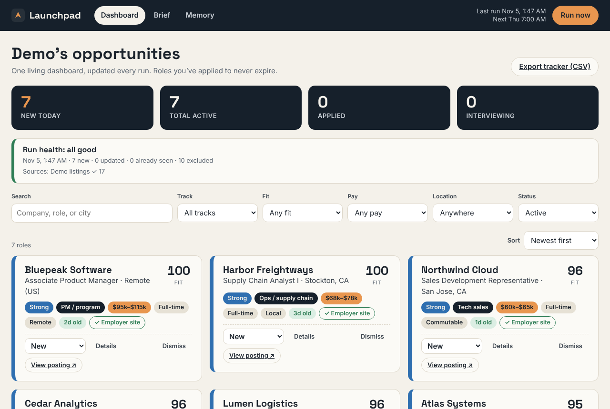
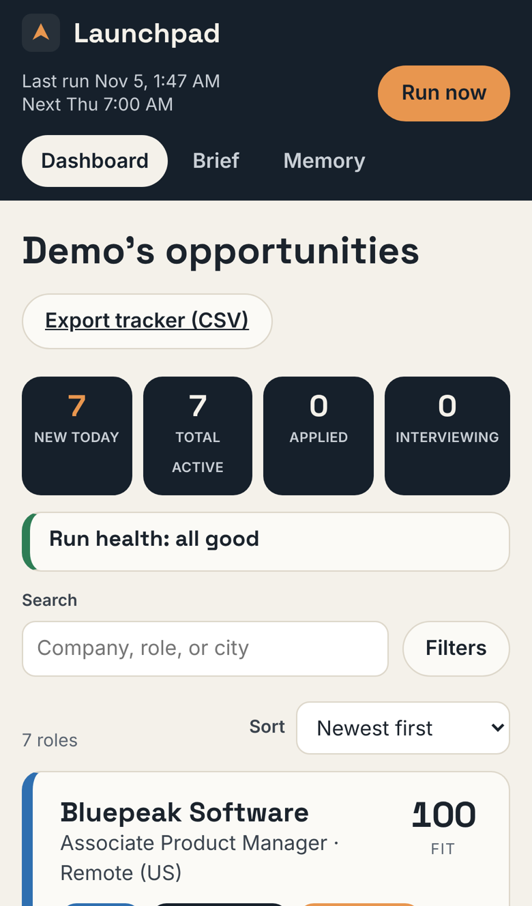

# Launchpad

[](https://github.com/925-seb/Sebastian-Oviedo/actions/workflows/test.yml)

**An early-career job search that runs every morning, even when you don't.**

Launchpad helps students and recent grads find roles they can realistically land. You answer a two-minute questionnaire (or drop in your resume or LinkedIn PDF). Each day it searches employer career pages, checks that postings are still live, scores every role against your background, and keeps the strong and realistic fits on one dashboard that doubles as your application tracker.

It started as my own job-search tool. It surfaced the Sales Development Representative role at Oracle that led to my interview and full-time offer. The next goal is to open it up to students, starting with **San José State University** and **Delta College**.

<p>
  
  
</p>

## What it does

- **One brief, then it runs itself.** Your degree, graduation date, experience, skills, up to four career tracks, locations and pay floor become the rules every search follows.
- **Only realistic fits.** Roles needing a Master's, clearance, a CS-only degree, five-plus years, or commission-only pay are screened out. Stretch roles are flagged with the reason instead of hidden.
- **Straight from employers.** Searches Greenhouse, Lever and Ashby career pages directly, plus The Muse and (optionally) Adzuna.
- **A tracker that remembers.** Mark roles Interested, Applied, Interviewing or Offer. Dismiss reasons you repeat become standing rules. Export everything to CSV.

## Try it

Requires Node 18 or newer. No dependencies to install.

```bash
cd launchpad
npm run demo
```

Open http://127.0.0.1:3000 to see it with built-in sample jobs. Use `npm start` for real searches, and `npm test` to run the tests.

Full documentation, including how scoring and the rules work, is in [`launchpad/README.md`](launchpad/README.md).

## Status

Launchpad currently runs as a single-user app on your own computer. Accounts, hosting and school-specific onboarding for SJSU and Delta College are the next milestones.

## License

[MIT](LICENSE). Originally built for BUS4-110B, Systems Analysis and Design, at San José State University.
